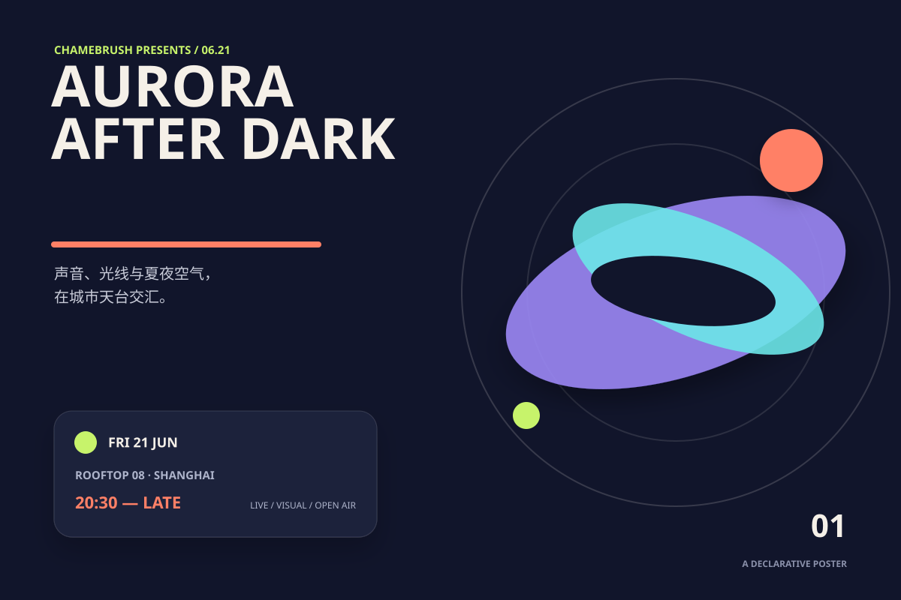
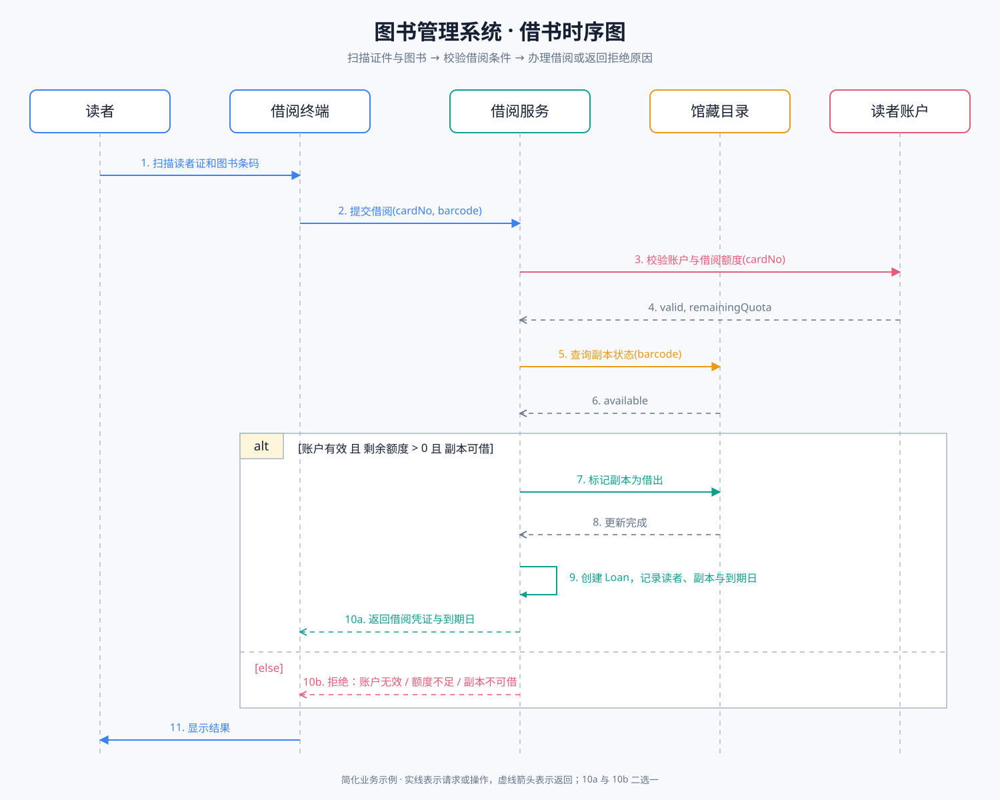
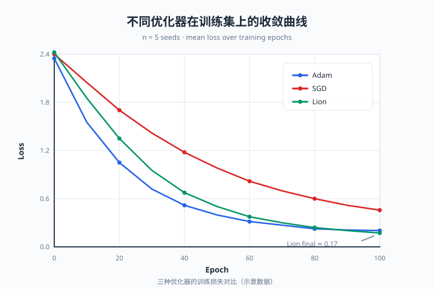

<p align="center">
  
</p>

<h1 align="center">Chamebrush</h1>

<p align="center">
  用声明式代码绘制二维图形。
  <br />
  一份 <code>.chame</code> 源码，可输出 SVG、PNG 和 WebP。
</p>

<p align="center">
  <a href="docs/language-spec.md">语言规范</a> ·
  <a href="examples">示例</a> ·
  <a href="#参与贡献">参与贡献</a> ·
  <a href="LICENSE">MIT 许可证</a>
</p>

> [!IMPORTANT]
> Chamebrush 目前处于 `0.1` MVP 阶段，语法和公共 API 尚未承诺向后兼容。

Chamebrush 是一门实验性的声明式二维绘图语言。编译器将 `.chame` 源码转换为与输出格式无关的场景树，再由渲染后端生成 SVG，或进一步栅格化为 PNG/WebP。核心编译和 SVG 渲染包不依赖 Node.js API，可以同时运行在浏览器和 Node.js 中。

## 特性

- 简洁的块式绘图语法，以及带源码位置的编译诊断；
- 矩形、圆、椭圆、线、折线、多边形、路径、文本、图片和连接器；
- 变量、表达式、二维元组、列表和百分比；
- 内置与自定义锚点，适合绘制流程图和架构图；
- 分组、平移、旋转、缩放、透明度、阴影和描边样式；
- 多画布文件与基于画布的逐帧预览；
- SVG、PNG、WebP 导出；
- 可供 AI Agent 调用的 Skill、JSON CLI 输出和 MCP App 预览；
- React/Vite Playground，内置 CodeMirror 6、Lezer 增量解析和实时预览。

> 变量名、画布名和对象名不能包含连字符；请使用 `furDark` 或 `legFront` 这样的 camelCase 名称。`font-size`、`line-cap` 等命令名可以包含连字符。

## 示例

```chame
let accent "#168a89"

canvas hello {
  size (640, 360)
  background "#f6f3e8"

  circle badge {
    center (320, 150)
    radius 72
    fill accent
  }

  text title {
    content "Hello, Chamebrush!"
    at (320, 270)
    color "#173b3a"
    font-size 28
    font-weight 700
    align center
  }
}
```

完整语法、类型规则、对象命令和默认值见 [Chamebrush 0.1 语言规范](docs/language-spec.md)。更多可直接运行的程序位于 [`examples/`](examples)：

| 示例 | 源码 | 输出 |
| --- | --- | --- |
| 极光音乐夜海报 | [aurora-poster.chame](examples/aurora-poster.chame) | [aurora-poster.svg](examples/aurora-poster.svg) |
| 图书借阅时序图 | [library-borrow-sequence.chame](examples/library-borrow-sequence.chame) | [library-borrow-sequence.svg](examples/library-borrow-sequence.svg) |
| 科研折线图 | [line-chart.chame](examples/line-chart.chame) | [line-chart.svg](examples/line-chart.svg) |

<p align="center">
  
  <br />
  <sub>示例 1：极光音乐夜海报</sub>
</p>

<p align="center">
  
  <br />
  <sub>示例 2：图书借阅时序图</sub>
</p>

<p align="center">
  
  <br />
  <sub>示例 3：科研折线图——坐标轴</sub>
</p>

## 快速开始

### 通过 npm 安装 CLI

需要 Node.js 20.9 或更高版本。全局安装 Chamebrush CLI：

```bash
npm install --global @chamebrush/cli
```

将上面的示例保存为 `hello.chame`，然后生成 SVG：

```bash
chame render hello.chame -o hello.svg
```

输出 PNG 或 WebP 时，可以用 `--scale` 设置像素缩放倍数：

```bash
chame render hello.chame -o hello.png --scale 2
chame render hello.chame -o hello.webp --scale 2
```

### 从源码开发

从源码运行 Playground 还需要 Corepack 和 `package.json` 中固定的 pnpm 版本。获取代码并进入仓库根目录后运行：

```bash
corepack enable
pnpm install
pnpm dev
```

`pnpm dev` 启动 Playground，默认地址为 <http://localhost:4173>。页面提供实时编辑、错误标记、画布预览，以及 SVG、PNG 和 WebP 导出。

## 命令行使用

安装 `@chamebrush/cli` 后使用：

```text
chame render <input.chame> -o <output.svg|png|webp> [--canvas name] [--scale number]
```

例如：

```bash
chame render drawing.chame -o drawing.svg
chame render drawing.chame -o drawing.png --scale 2
chame render drawing.chame -o drawing.webp --canvas main --scale 2
chame render drawing.chame -o drawing.svg --json
```

在源码仓库中，也可以使用开发命令：

```bash
pnpm cli examples/logo.chame examples/logo.svg
```

CLI 行为：

- 输出格式由输出文件扩展名决定；
- `--scale` 只影响 PNG/WebP 像素尺寸，默认值为 `1`，且必须大于 `0`；
- `--canvas` 只输出指定画布；
- 未指定 `--canvas` 时编译全部画布，多画布文件输出为 `<文件名>-<画布名>.<扩展名>`；
- 非 `data:` 图片路径相对于输入 `.chame` 文件解析，远程 URL 会被拒绝；
- `animation` 配置不会生成动画文件，每个 `canvas` 仍导出为独立静态图。
- `--json` 将成功结果或源码诊断作为单行 JSON 写到标准输出，适合 AI Agent 和自动化程序调用。

## AI Agent Skill 与交互预览

[`skills/chamebrush-drawing`](skills/chamebrush-drawing) 提供绘图工作流和自包含的语法速查表。Skill 的运行时不依赖本仓库：MCP Viewer 通过 npm 包 `@chamebrush/mcp` 启动，纯终端回退则使用 npm 包 `@chamebrush/cli`。用户只需安装 Skill，并在客户端中注册下方的 MCP 服务器。

`@chamebrush/mcp` 暴露 `chamebrush_render` 工具。Skill 要求 Agent 在该工具可用时必须用它执行最终验证，因为只有 MCP 工具调用会创建 Viewer。支持 MCP Apps 的 Codex、ChatGPT 或其他客户端会显示可切换的“预览 / 代码”界面；不支持 MCP Apps UI 的客户端仍会收到完整源码、文本摘要和结构化编译结果，因此同一套 Skill 也可以在纯终端 Agent 中使用。

发布包安装后，可将以下 stdio 服务器加入客户端的 MCP 配置：

```json
{
  "command": "npx",
  "args": ["-y", "@chamebrush/mcp"]
}
```

在源码仓库中开发时，先构建包，然后直接运行本地入口：

```bash
pnpm --filter @chamebrush/mcp build
node packages/mcp/dist/main.js
```

富界面遵循渐进增强：支持 MCP Apps 的宿主直接显示交互 Viewer，并以 Viewer 作为主要结果，不再默认重复附加图片和多种格式文件；其他宿主由 Skill 返回 `chame` fenced code block，以及一种 SVG/PNG 预览。Codex 无需注入自定义 Markdown renderer，代码/预览切换由标准 MCP Apps UI 提供。工具卡片在思考过程中的折叠状态由宿主控制，MCP App 不能强制展开。

## 浏览器 API

```bash
npm install @chamebrush/browser
```

```ts
import {
  compile,
  compileAll,
  renderPngBlob,
  renderSourceToBlob,
  renderSvg,
  renderSvgBlob,
  renderWebpBlob,
} from "@chamebrush/browser";

const result = compile(source, { canvas: "main" });

if (result.ok) {
  const markup = renderSvg(result.scene);
  const svg = await renderSvgBlob(result.scene);
  const png = await renderPngBlob(result.scene, 2);
  const webp = await renderWebpBlob(result.scene, 2);
}

const documentResult = compileAll(source);
if (documentResult.ok) {
  console.log(documentResult.scenes, documentResult.animation?.fps);
}

const file = await renderSourceToBlob(source, {
  format: "png",
  canvas: "main",
  scale: 2,
});
```

`compile` 返回指定画布，未指定名称时返回第一张；`compileAll` 按源码顺序返回全部画布，并在存在 `animation` 块时返回播放配置。失败结果通过 `diagnostics` 提供行列位置。

## 逐帧播放

在文档顶层声明播放帧率：

```chame
animation {
  fps 12
}
```

Playground 会把每个 `canvas` 视为一帧并按声明顺序循环。`fps` 必须是 `1`–`120` 的无单位数值字面量。只有一个画布时保持静态；没有 `animation` 块时，通过按钮手动切换多个画布。所有导出仍是静态帧。

## 项目架构

```text
.chame source
      │
      ▼
Source AST ── diagnostics
      │
      ▼
semantic compiler
      │
      ▼
renderer-independent Scene
      │
      ├──► SVG
      └──► SVG ──► PNG / WebP
```

| 路径 | 职责 |
| --- | --- |
| `packages/language` | 手写解析器、源码 AST、Lezer 文法与增量语法树 |
| `packages/core` | 语义检查、表达式求值、锚点解析与场景树 |
| `packages/renderer-svg` | 纯 TypeScript 的 Scene → SVG 渲染器 |
| `packages/browser` | 浏览器公共 API 与 Canvas 位图导出 |
| `packages/cli` | Node.js CLI、资源校验与 Sharp 位图导出 |
| `packages/mcp` | AI Agent 渲染工具与可切换代码/预览的 MCP App |
| `apps/playground` | React/Vite 编辑器、实时预览与逐帧播放 |
| `examples` | 可执行 `.chame` 示例和约定提交的 SVG |
| `docs` | 正式语言规范和设计文档 |

编译器使用 `packages/language/src/index.ts` 中的手写解析器；编辑器使用 `packages/language/src/chamebrush.grammar` 中的 Lezer 文法。修改语言时必须同步维护两者。

## 开发

| 命令 | 用途 |
| --- | --- |
| `pnpm dev` | 启动 Playground |
| `pnpm typecheck` | 运行严格 TypeScript 检查 |
| `pnpm test` | 运行一次 Vitest 测试 |
| `pnpm test:watch` | 以监听模式运行测试 |
| `pnpm build` | 类型检查并构建所有公共包与 Playground |
| `pnpm build:packages` | 构建五个 npm 包到各自的 `dist/` |
| `pnpm build:playground` | 构建 Playground 到 `dist/playground` |
| `pnpm release:check` | 运行检查、测试、构建和 npm 发布预演 |
| `pnpm --filter @chamebrush/language generate` | 根据 Lezer 文法重新生成解析器 |

## 当前限制

当前版本在文本测量、曲线路径边界和连接器路由方面使用近似计算。具体行为见语言指南的[当前限制](docs/language-spec.md#13-当前限制)。

## 参与贡献

欢迎通过 Issue 或 Pull Request 提交问题、设计讨论和实现改进。

## 许可证

Chamebrush 采用 [MIT License](LICENSE) 开源。
